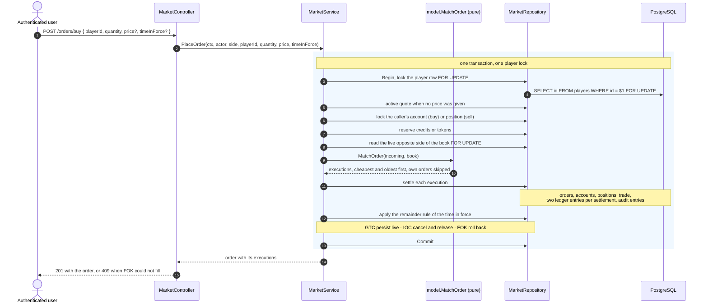

# Implementation Plan: Player Token Market (Mercado de tokens)

**Branch**: `005-mercado-de-tokens` | **Date**: 2026-10-17 | **Spec**: [spec.md](./spec.md)

**Input**: [spec.md](./spec.md), with the design decisions recorded in [research.md](./research.md) and the schema and domain model in [data-model.md](./data-model.md).

## Summary

An order book for player tokens, with a price-time priority matcher, where the superuser is a market maker holding the 100 issued tokens of each player and resting them at the active quote.

Five things define the shape of the implementation:

1. **The active quote is the default price.** An order without a price is priced at the player's active quote, which is the operation section 3.3 of the vision document describes. A price turns the order into a real limit order.
2. **Time in force bounds the remainder.** `GTC` rests it, `IOC` cancels it, `FOK` rejects the whole order. Defaults: no price means `FOK`, a price means `GTC`.
3. **The book is per transaction.** The matcher is a pure function over the resting orders read and locked inside the transaction that is placing the order. There is no long-lived in-memory book.
4. **Serialization is by player.** A row lock on the player is taken before anything else in the operation, which serializes that player's whole book and leaves other players concurrent.
5. **Credits are fixed-point integers.** A `Credits` type in units of 1/10000 of a credit, mapped to `BIGINT`, rendered as a decimal only at the HTTP edge.

## Technical Context

**Language/Version**: Go, version declared in `backend/go.mod`.

**Primary Dependencies**: standard library `net/http` and `database/sql` only, per constitution principles I and II. No new dependency.

**Storage**: PostgreSQL in Docker. Six new tables and one new sequence, defined in [data-model.md](./data-model.md): `user_accounts`, `user_positions`, `market_orders`, `market_trades`, `ledger_entries`, `player_quotes`. No new audit table: the existing generic `AuditDAO` is reused.

**Testing**: standard `testing` with table-driven cases; `testcontainers-go` for everything that touches persistence, per principle XIII. The matcher, the order state machine, the reservation arithmetic and the portfolio calculation are pure and tested without a database.

**Target Platform**: Linux in Docker for CI, local host for development.

## Constitution Check

*GATE: passed before writing tasks. Re-check before the first commit.*

| Principle | How this feature complies |
|---|---|
| I. Backend en Go con net/http | Endpoints registered in `routes.go` through `httphandler.Wrap`, like every existing route |
| II. Persistencia en PostgreSQL | Raw parameterized SQL in DAOs, no ORM |
| III. Arquitectura en capas | `model` is pure, `dao` is SQL, `repository` owns the transaction, `service` orchestrates, `controller` maps to HTTP; `context.Context` on every I/O call |
| IV. Inyección de dependencias | `New...` constructors, interfaces injected, assembly in `cmd/server/main.go` through the existing container files |
| V. DTOs en el borde | Request and response DTOs in `internal/controller/dto/market.go` with `DesdeModelo` factories; no `json` tags in `model` |
| VI. Frontend | Backend first; the contract this delivers is what the market screens of section 9 consume |
| VII. API REST OpenAPI | Every route documented in `backend/api/openapi.yaml` with `x-access-level`, verified by the existing `contract_test.go` |
| VIII. Seguridad JWT | All routes `AccessAuthenticated`; the acting user comes from the request context, never from the body |
| IX. Observabilidad | Structured logging with the existing logger and correlation id; no balance, token or credential value logged at info level |
| X. Auditoría transaccional | Every balance, position and order change writes an audit entry with actor and before/after through the existing `AuditDAO`, inside the same transaction |
| XI. Integridad de datos | One transaction per operation, row lock on the player, check constraints forbidding negative balances and positions |
| XII. Resiliencia | The market reads only local state; it does not call any external API, so a provider outage cannot affect trading |
| XIII. Testing | Pure model tests, repository and service integration tests with testcontainers, concurrency tests, controller contract tests, and the section 8.3 scenario end to end |
| XIV. Preservación | No existing comment, string or test is modified |

**Complexity gate**: this feature adds machinery the enunciado does not ask for. The justification, item by item, with its cost and the mechanical path to cut it, is section 7 of [research.md](./research.md).

## Source layout

Paths verified against the working tree. `[new]` files do not exist yet; `[mod]` files exist and are extended.

```text
backend/
├── api/
│   └── openapi.yaml                      [mod] market paths and schemas
├── db/
│   └── init.sql                          [mod] six tables and one sequence
└── internal/
    ├── configuration/
    │   └── configuration.go              [mod] InitialUserBalance
    ├── model/
    │   ├── credits.go                    [new] Credits fixed-point type
    │   ├── order.go                      [new] Order, side, time in force, status, state machine
    │   ├── matching.go                   [new] MatchOrder, pure price-time priority
    │   ├── account.go                    [new] Account with reservations
    │   ├── position.go                   [new] Position, cost basis, average price
    │   ├── trade.go                      [new] Trade and LedgerEntry
    │   ├── quote.go                      [new] PlayerQuote
    │   └── portfolio.go                  [new] BuildPortfolio
    ├── persistence/
    │   ├── dao/
    │   │   ├── user_sql.go               [mod] additive InsertTx for the atomic registration grant
    │   │   ├── account_sql.go            [new]
    │   │   ├── position_sql.go           [new]
    │   │   ├── order_sql.go              [new]
    │   │   ├── trade_sql.go              [new]
    │   │   ├── ledger_sql.go             [new]
    │   │   ├── quote_sql.go              [new]
    │   │   ├── player_sql.go             [mod] lock a player row for update
    │   │   └── container.go              [mod]
    │   └── repository/
    │       ├── market.go                 [new] transaction boundary, settlement
    │       ├── portfolio.go              [new] read side of the portfolio
    │       └── container.go              [mod]
    ├── service/
    │   ├── market.go                     [new] PlaceOrder, CancelOrder, ListOpenOrders
    │   ├── market_maker.go               [new] bootstrap and re-pricing
    │   ├── portfolio.go                  [new] portfolio and transaction history
    │   ├── auth.go                        [mod] account on registration and on superuser bootstrap
    │   ├── player_sync.go                [mod] bootstrap new players after a sync
    │   └── container.go                  [mod]
    ├── controller/
    │   ├── dto/
    │   │   └── market.go                 [new] requests, responses, DesdeModelo
    │   ├── market.go                     [new] handlers
    │   └── container.go                  [mod]
    └── server/
        └── routes.go                     [mod] six routes with their access level
```

Two layout decisions, both following what the repository already does rather than introducing a form:

- **DTOs go in `internal/controller/dto`**, not `internal/dto`. The split in this repository is that `internal/dto` holds shapes the service layer itself returns, such as the player catalog and the sync result, while `internal/controller/dto` holds shapes that exist only at the HTTP edge. Market services return domain models, so market DTOs belong at the edge.
- **The matcher lives in `model`, not in `service`.** It is a pure function over orders with no dependency and no I/O, which is the definition of the model layer here, and it is what makes its tests database-free.

## Routes

| Method | Path | Access | Operation |
|---|---|---|---|
| POST | `/orders/buy` | authenticated | Place a buy order |
| POST | `/orders/sell` | authenticated | Place a sell order |
| GET | `/orders` | authenticated | List the caller's live orders |
| DELETE | `/orders/{id}` | authenticated | Cancel a live order of the caller |
| GET | `/users/{id}/portfolio` | authenticated | Portfolio of a user, own or any if superuser |
| GET | `/users/{id}/transactions` | authenticated | Executed trades of a user, own or any if superuser |

Every route goes in three places or it breaks: `routes.go`, `backend/api/openapi.yaml` with its `x-access-level`, and the access level in the route table. A route that declares no access level panics at startup by design, and the contract test fails on any route missing from the published document.

The two routes beyond the table in section 4 of the vision document, `GET /orders` and `DELETE /orders/{id}`, exist because orders rest: without them a reservation held by an order that never crosses could not be recovered.

## Request and response shapes

Field names are camelCase, following the published contract of the domain resources (`externalId`, `leagueCode`, `totalPages`). The snake_case of the session DTO is an OAuth-shaped exception, not the convention.

```text
POST /orders/buy      { playerId, quantity, price?, timeInForce? }
POST /orders/sell     { playerId, quantity, price?, timeInForce? }
  201 -> { id, side, playerId, quantity, executedQuantity, remainingQuantity,
           price, timeInForce, status, createdAt, trades: [ { quantity, price, totalAmount, executedAt } ] }
  400 validation, 404 unknown or inactive player,
  409 cannot be filled in full under FOK, 422 insufficient funds or tokens

GET /orders?playerId=
  200 -> { items: [ { id, side, playerId, price, quantity, executedQuantity,
                      remainingQuantity, timeInForce, status, createdAt } ] }

DELETE /orders/{id}
  200 -> { id, status, releasedCredits?, releasedTokens? }
  403 not the owner, 404 unknown order, 409 already final

GET /users/{id}/portfolio
  200 -> { userId, availableCash, reservedCash, tokensValuation, totalValue, unrealizedResult,
           positions: [ { playerId, playerName, clubName, position, quantity,
                          averagePrice, currentPrice, currentValuation, unrealizedResult } ] }
  403 another user without superuser privilege

GET /users/{id}/transactions?page=&limit=
  200 -> { items: [ { id, side, playerId, playerName, quantity, price, totalAmount, executedAt } ],
           total, page, limit, totalPages }
  403 another user without superuser privilege
```

The transaction page mirrors the `PlayerPage` shape already published (`items`, `total`, `page`, `limit`, `totalPages`) rather than introducing a second pagination envelope.

## Order placement flow



## Market maker

One service with two entry points, both idempotent:

- **Bootstrap**, called after the superuser exists at startup and after every player synchronization. For each player with no market position: record the initial quote of 1 credit, create the superuser position with 100 tokens, and rest a sell order for the tokens not already sold at the active quote. The three idempotency guards are in the schema, not in the code: `uq_positions_user_player`, `uq_quotes_player_initial` and `uq_orders_market_maker_live`.
- **Re-pricing**, called whenever a quote is recorded for a player. The live market maker order of that player is cancelled and reposted at the new price for the quantity still available. Orders of regular users are never touched. Without this the first recalculation of section 3.2 would leave inventory offered at a stale price, which any user could take at a discount.

## Phases

**Phase 1 — foundations.** Schema in `init.sql`. `Credits`, `Order` with its state machine, `Account`, `Position`, `MatchOrder`, `PlayerQuote`, `Trade`, `LedgerEntry`, `BuildPortfolio`, each with its pure unit tests. Nothing here touches a database, so this phase ends with the whole domain green and no container started.

**Phase 2 — persistence.** The six DAOs, the player lock, and the two repositories with the transaction boundary and the settlement. Integration tests with testcontainers covering every query, the three partial unique indexes and the check constraints.

**Phase 3 — placement and cancellation.** `MarketService` with `PlaceOrder`, `CancelOrder` and `ListOpenOrders`. One service test per time in force against the same book state, the reservation release on every non-executing path, cancellation of a partially executed order, a remainder that crosses later, and the concurrency tests over the last tokens of a player and over one user's credits.

**Phase 4 — bootstrap and registration.** `MarketMakerService` with its bootstrap and re-pricing, `InitialUserBalance` in the configuration, the account created on registration and for the superuser, and the bootstrap call after a player sync. The registration grant is atomic with the user insert, through an additive `InsertTx` on the concrete user DAO that leaves the existing interface and the feature 002 mocks untouched. The existing tests of features 002 and 003 must stay green untouched.

**Phase 5 — edge and contract.** `PortfolioService` over the read-side repository, then DTOs, controller, routes, the published OpenAPI document, controller tests including authorization of another user's portfolio, history and orders, and the end-to-end scenario of section 8.3: four users, five players each, valuation reported after the quotes move.

Each phase ends green before the next begins, and each task inside a phase is its own small commit.

## Risks

| Risk | Mitigation |
|---|---|
| A reservation left held by an order that is no longer live | Asserted as an invariant: the sum of reserved balances must equal what live orders reserve. Checked after every service test, not only in the happy path |
| Integer truncation in the cost basis | A sale of the entire position assigns the whole remaining cost basis instead of computing a proportion, so no residue can survive on a position with zero tokens |
| The player lock becoming a bottleneck | Accepted. Contention is per player, which is the grain the invariants need, and the workload of this system is nowhere near it |
| Touching features 002 and 003 on their write path | Their tests are the regression gate and may not be modified; the bootstrap is idempotent at the schema level so repeated syncs are safe |
| The published contract drifting from the routes | The existing contract test already fails on any route missing from the document, and an undeclared access level panics at startup |
