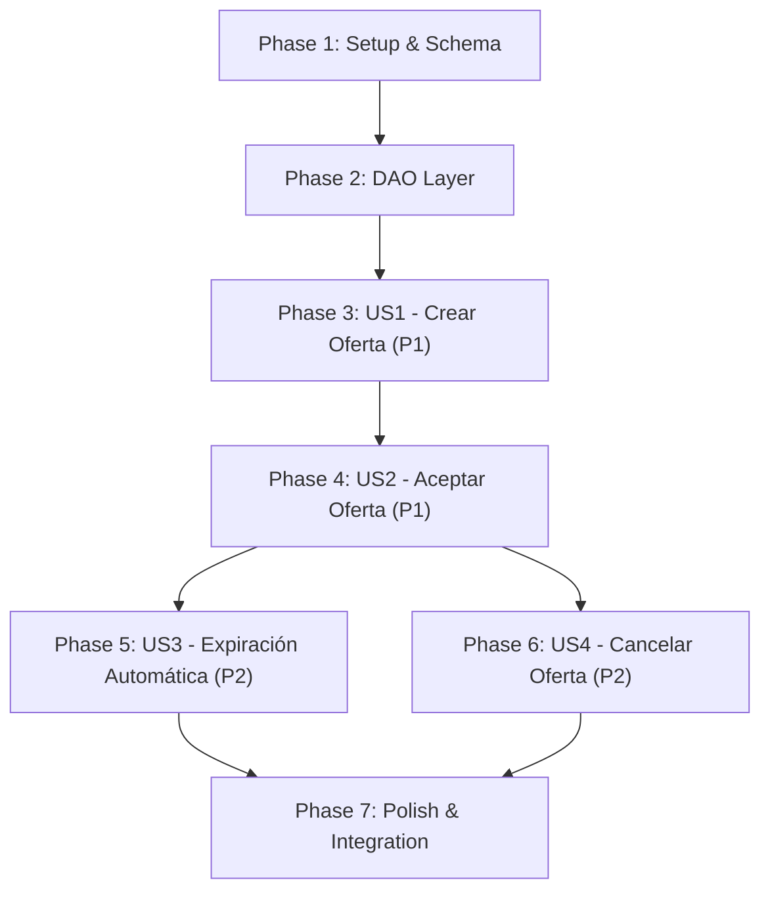

# Tasks: Transacción P2P de Tokens

**Input**: Design documents from `specs/006-transaccion-p2p-tokens/` (`spec.md`, `plan.md`, `data-model.md`, `contracts/p2p-api.yaml`, `quickstart.md`, `research.md`)

**Prerequisites**: `plan.md` (completed), `spec.md` (completed)

**Organization**: Las tareas están agrupadas por fase y por User Story para permitir avance incremental e independiente.

---

## Format: `- [ ] [ID] [P?] [Story?] Description with file path`

- **[P]**: Ejecución en paralelo permitida (archivos diferentes sin dependencias cruzadas)
- **[Story]**: Mapeo directo a la User Story (`[US1]`, `[US2]`, `[US3]`, `[US4]`)
- Rutas absolutas o relativas al root del repositorio

---

## Phase 1: Setup & Foundational Schema

**Purpose**: Esquema de persistencia, contrato OpenAPI y estructuras base del modelo de dominio.

- [X] T001 Actualizar el esquema de base de datos añadiendo la tabla `p2p_sessions` y la columna `p2p_session_id` en `market_trades` en `backend/db/init.sql`
- [X] T002 [P] Actualizar el modelo `Trade` para incluir el campo opcional `P2PSessionID *int64` en `backend/internal/model/trade.go`
- [X] T003 [P] Crear el modelo de dominio `P2PSession`, sus estados (`PENDING`, `COMPLETED`, `CANCELLED`, `EXPIRED`) y errores sentinel en `backend/internal/model/p2p_session.go`
- [X] T004 Actualizar la especificación OpenAPI principal integrando los 4 endpoints de `/p2p/sessions` con `x-access-level: authenticated` y schemas correspondientes en `backend/api/openapi.yaml`
- [X] T005 [P] Crear los DTOs de request y response para sesiones P2P en `backend/internal/controller/dto/p2p.go`

**Checkpoint**: Esquema y modelos base listos.

---

## Phase 2: Foundational Persistence & DAO

**Purpose**: Capa granular de acceso a datos para sesiones P2P y soporte de persistencia de trades vinculados.

- [X] T006 Crear el DAO `P2PSessionSql` con métodos `Insert`, `GetByToken`, `LockByToken`, `UpdateStatus` y `ListPendingExpired` en `backend/internal/persistence/dao/p2p_session_sql.go`
- [X] T007 Modificar `TradeSql` para persistir y leer la columna `p2p_session_id` en `backend/internal/persistence/dao/trade_sql.go`
- [X] T008 Registrar `P2PSession` en el contenedor de DAOs en `backend/internal/persistence/dao/container.go`
- [X] T009 Añadir `p2p_sessions` a `expectedTables` en `backend/cmd/server/main.go`

**Checkpoint**: DAOs implementados y registrados en el contenedor de persistencia.

---

## Phase 3: User Story 1 - Crear Oferta de Venta P2P (Priority: P1) 🎯 MVP

**Goal**: Permitir al vendedor autenticado crear una oferta directa fijando jugador, cantidad y precio, reservando los tokens en escrow y obteniendo un link único.

**Independent Test**: Registrar/loguear vendedor con tokens disponibles, invocar creación de sesión P2P, verificar estado `PENDING`, reserva en `user_positions` y obtención de UUID de sesión.

### Implementation for User Story 1

- [X] T010 [US1] Implementar método `Create` en `P2PRepository` asegurando la reserva de tokens en `user_positions` y el registro de auditoría en `backend/internal/persistence/repository/p2p.go`
- [X] T011 [US1] Registrar `P2PRepository` en el contenedor de repositorios en `backend/internal/persistence/repository/container.go`
- [X] T012 [US1] Implementar método `Create` en `P2PService` validando disponibilidad de tokens y expiración a 5 minutos en `backend/internal/service/p2p.go`
- [X] T013 [US1] Implementar endpoint `Create` en `RestP2PController` mapeando validaciones y errores HTTP en `backend/internal/controller/p2p.go`
- [X] T014 [US1] Registrar `RestP2PController` en el contenedor de controladores en `backend/internal/controller/container.go`
- [X] T015 [US1] Registrar la ruta `POST /p2p/sessions` con `AccessAuthenticated` en `backend/internal/server/routes.go`
- [X] T016 [P] [US1] Crear el módulo de llamadas HTTP tipadas `createP2PSession` en `frontend/src/api/p2p.ts`
- [X] T017 [US1] Crear la página de creación de ofertas `P2PCreatePage.tsx` y sus estilos BEM en `frontend/src/pages/P2PCreatePage/P2PCreatePage.tsx` y `frontend/src/pages/P2PCreatePage/P2PCreatePage.css`

**Checkpoint**: User Story 1 operativa. Un vendedor puede crear una oferta y copiar el link.

---

## Phase 4: User Story 2 - Visualizar y Aceptar Oferta P2P como Comprador (Priority: P1)

**Goal**: Permitir a otro usuario autenticado abrir el enlace, ver los emails de ambos participantes, tiempo restante y aceptar la oferta (transfiriendo tokens y créditos atómicamente). Si ya fue tomada por otro usuario, responder con error 409 claro.

**Independent Test**: Abrir link con comprador con créditos suficientes, aceptar oferta, verificar actualización de balances en ambas cuentas, estado `COMPLETED` y que un segundo intento de aceptación sea rechazado con HTTP 409.

### Implementation for User Story 2

- [X] T018 [US2] Implementar métodos `GetByToken` y `Accept` en `P2PRepository` con bloqueo pesimista `SELECT ... FOR UPDATE`, liquidación atómica (tokens + créditos), trade y ledger en `backend/internal/persistence/repository/p2p.go`
- [X] T019 [US2] Implementar métodos `Get` y `Accept` en `P2PService` validando comprador distinto a vendedor y saldo suficiente en `backend/internal/service/p2p.go`
- [X] T020 [US2] Implementar endpoints `Get` y `Accept` en `RestP2PController` con mapeo de errores (`ErrP2PSessionAlreadyTaken` -> 409, `ErrInsufficientFunds` -> 422) en `backend/internal/controller/p2p.go`
- [X] T021 [US2] Registrar las rutas `GET /p2p/sessions/{token}` y `POST /p2p/sessions/{token}/accept` en `backend/internal/server/routes.go`
- [X] T022 [P] [US2] Agregar funciones `getP2PSession` y `acceptP2PSession` en `frontend/src/api/p2p.ts`
- [X] T023 [US2] Crear el componente `P2PSessionPage.tsx` mostrando emails de vendedor y comprador, detalles de la oferta, countdown de 5 min y botón aceptar en `frontend/src/pages/P2PSessionPage/P2PSessionPage.tsx` y `frontend/src/pages/P2PSessionPage/P2PSessionPage.css`
- [X] T024 [US2] Implementar en `P2PSessionPage.tsx` el estado visual de "Oferta Tomada" cuando la sesión ya está en estado `COMPLETED` o la API devuelve 409

**Checkpoint**: User Stories 1 y 2 operativas. El ciclo de compra/venta directa entre 2 usuarios se completa exitosamente.

---

## Phase 5: User Story 3 - Expiración Automática de la Sesión P2P (Priority: P2)

**Goal**: Cancelar automáticamente toda sesión que supere los 5 minutos sin ser aceptada, liberando los tokens en escrow del vendedor, y mostrando error amigable tanto en API (410) como en UI.

**Independent Test**: Crear sesión P2P, adelantar el tiempo o esperar vencimiento, verificar que el job pasa la sesión a `EXPIRED`, libera la reserva de tokens y la UI muestra el panel de "Oferta Vencida".

### Implementation for User Story 3

- [X] T025 [US3] Implementar método `ExpirePending` en `P2PRepository` liberando tokens reservados y registrando auditoría en `backend/internal/persistence/repository/p2p.go`
- [X] T026 [US3] Crear el background worker `P2PExpirationJob` con ticker de 30 segundos gobernado por el ciclo de vida del proceso en `backend/internal/service/p2p_expiration.go`
- [X] T027 [US3] Instanciar `P2PExpirationJob` en el contenedor de servicios en `backend/internal/service/container.go`
- [X] T028 [US3] Iniciar y detener `P2PExpirationJob` en el ciclo de vida del servidor en `backend/cmd/server/main.go`
- [X] T029 [US3] Asegurar el mapeo de `ErrP2PSessionExpired` a HTTP 410 con mensaje amigable en `backend/internal/controller/p2p.go`
- [X] T030 [US3] Implementar en `P2PSessionPage.tsx` el panel estilizado de "Oferta Vencida" cuando el countdown llega a 0 o el backend responde 410 en `frontend/src/pages/P2PSessionPage/P2PSessionPage.tsx`

**Checkpoint**: Las sesiones expiran solas y los tokens no quedan atrapados en escrow.

---

## Phase 6: User Story 4 - Cancelar la Sesión como Vendedor (Priority: P2)

**Goal**: Permitir al vendedor cancelar manualmente una sesión en estado `PENDING` antes de que expire, liberando inmediatamente sus tokens.

**Independent Test**: Como vendedor, presionar "Cancelar" sobre una oferta activa; verificar estado `CANCELLED` y liberación de tokens en portfolio.

### Implementation for User Story 4

- [X] T031 [US4] Implementar método `Cancel` en `P2PRepository` liberando tokens del vendedor en `backend/internal/persistence/repository/p2p.go`
- [X] T032 [US4] Implementar método `Cancel` en `P2PService` validando que únicamente el vendedor pueda cancelar en `backend/internal/service/p2p.go`
- [X] T033 [US4] Implementar endpoint `Cancel` en `RestP2PController` respondiendo 204 No Content en `backend/internal/controller/p2p.go`
- [X] T034 [US4] Registrar la ruta `POST /p2p/sessions/{token}/cancel` en `backend/internal/server/routes.go`
- [X] T035 [P] [US4] Agregar función `cancelP2PSession` en `frontend/src/api/p2p.ts`
- [X] T036 [US4] Habilitar la acción de cancelación y retroalimentación visual en `frontend/src/pages/P2PSessionPage/P2PSessionPage.tsx`

**Checkpoint**: Cancelación manual por el vendedor funcional.

---

## Phase 7: Polish & Integration

**Purpose**: Integración de vistas en la navegación del frontend, validación end-to-end y verificación de calidad.

- [X] T037 Integrar navegación de `p2p-create` y `p2p-session` mediante query parameter `?token=` en `frontend/src/App.tsx`
- [X] T038 Añadir acceso directo a "Crear Oferta P2P" desde la barra de navegación o página de portfolio en `frontend/src/components/Navbar/Navbar.tsx` o `frontend/src/pages/PortfolioPage/PortfolioPage.tsx`
- [X] T039 Validar el contrato OpenAPI contra el enrutador ejecutando el test de contrato en `backend/internal/server/contract_test.go`
- [X] T040 Ejecutar validación de calidad del frontend (`npm run typecheck`, `npm run lint`) en `frontend/`
- [X] T041 Ejecutar verificación de calidad del backend (`golangci-lint` o `./scripts/pre-commit.sh`)

---

## Dependencies & Execution Order

### Phase Dependencies

### User Story Dependencies

- **US1 (Crear Oferta)**: Requiere Phase 1 y 2. Puede entregarse como MVP de generación de enlaces y reserva de escrow.
- **US2 (Aceptar Oferta)**: Requiere US1 (para existir una oferta que aceptar). Cierra el ciclo de transacción directa.
- **US3 (Expiración)**: Requiere el modelo de sesión y DAOs de US1/US2. Asegura resiliencia del escrow.
- **US4 (Cancelación)**: Requiere US1/US2. Agrega control manual al vendedor.

---

## Implementation Strategy

### MVP Scope (User Story 1 + User Story 2)
1. Completar Setup (Fases 1 y 2).
2. Implementar US1 (Creación de sesión y reserva de tokens).
3. Implementar US2 (Visualización con emails de ambos y aceptación atómica).
4. **Validar MVP**: El flujo de compra y venta directa entre dos usuarios queda 100% operativo.
5. Incorporar luego US3 (expiración a 5 minutos) y US4 (cancelación por vendedor).
